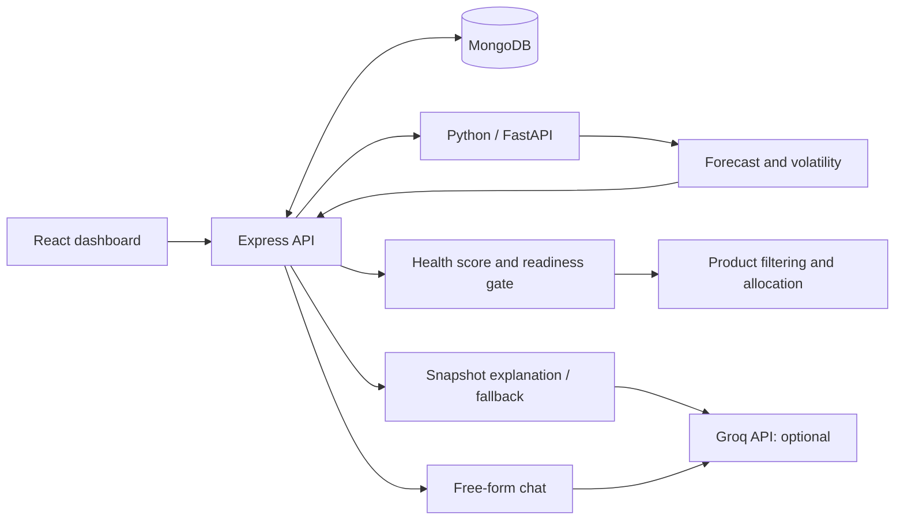

# Adaptive Finance

**Risk-aware financial decision support for gig workers with irregular income.**

Adaptive Finance is a B.Tech research prototype that connects daily income records to short-term forecasts, income-volatility classification, a financial-health score, and a conservative investment-readiness gate. A React dashboard presents the results; an Express API coordinates persistence and decisions; a Python service computes income analytics.

The application includes investment filtering and allocation, validated snapshot explanations with deterministic fallback, and a separate conversational assistant. Research tooling evaluates these components through chronological forecasting benchmarks, classification experiments, policy simulation, ablations, and automated tests.

This repository contains both the application and its research audit. Experimental candidates and reported results are documented separately from deployed behavior. **The system has not been validated as a financial advisory product or as a predictor of investment returns.**

## Documentation

| I want to… | Read |
|---|---|
| Install, configure, and run the application | [Startup and run commands](STARTUP.md) |
| Understand the data flow, algorithms, and decision rules | [Architecture and behavior](docs/ARCHITECTURE.md) |
| Integrate with the backend or Python service | [API reference](docs/API.md) |
| Find source files, run checks, or reproduce research | [Development guide](docs/DEVELOPMENT.md) |
| Read current evidence, metrics, and limitations | [Research evidence guide](docs/RESEARCH.md) |
| Review completed research work or prepare a presentation | [Work completed report and presentation plan](workdonebwcommits.md) |
| Inspect dataset origins and unresolved provenance | [Data provenance](PROVENANCE.md) |

## What the application does

1. **Collects financial context.** Users register, record bank balance, monthly expenses, debt, and existing investments, then enter dated income, platform, working hours, and completed orders.
2. **Analyzes income.** The Python service produces a daily forecast and classifies recent income variability using the coefficient of variation.
3. **Assesses readiness.** The backend combines liquidity, debt safety, income stability, forecast trend, and data consistency into a health score. A separate router requires every mandatory investment-readiness condition to pass.
4. **Builds constrained recommendations.** Eligible users receive a budget, a filtered ranking from a curated product catalogue, and integer allocations subject to minimum-investment constraints.
5. **Explains the snapshot.** Validated structured model responses select server-rendered explanations. A deterministic explanation is available when that model path fails. Free-form chat is a separate integration with different guarantees.

Income history, forecasts, health and decisions, investments, and chat are available from the authenticated dashboard. Income records can also be exported as CSV.

## System overview



The backend owns authentication, application state, health scoring, routing, investment decisions, and explanation validation. The Python service is stateless. Model-generated text does not determine the investment gate or allocation.

| Layer | Implementation | Default local address |
|---|---|---|
| Dashboard | React 19, Vite 8, React Router | `http://localhost:5173` |
| Application API | Node.js, Express 5, Mongoose | `http://localhost:5000` |
| Income analytics | Python, FastAPI, Uvicorn | `http://127.0.0.1:8000` |
| Storage | MongoDB | `mongodb://127.0.0.1:27017/lyproject` |
| Optional language model | Groq API, called by the backend | Configured in `server/.env` |

Follow [STARTUP.md](STARTUP.md) for setup, environment variables, commands, and health checks. A local MongoDB instance and three application processes are required. Provider credentials are optional for deterministic analytics and fallback explanations; live chat requires a working provider configuration.

## Current implementation and evidence

The deployed forecaster remains the mathematical trend-and-weekday method. Research compares it with simple, statistical, and learned alternatives; a candidate was not promoted because the validation guard did not pass. The runtime volatility classifier uses a recent-entry CV rule with revised thresholds. The conservative router fails closed on missing or structurally invalid financial and analytics inputs. The original financial-health weights remain in use because the evaluated replacement did not meet its selection requirements.

The strongest supported findings concern rule enforcement, a measured volatility-classification improvement on the documented target, allocation constraints, and numerical fidelity of constrained snapshot explanations. Forecast superiority, optimal health weights, real-world financial safety, investment profitability, and free-form chat reliability remain unestablished.

See the [research evidence guide](docs/RESEARCH.md) for dated numbers, datasets, negative findings, and the distinction between engineering checks and simulated outcomes. The latest consolidated numerical export is [results_for_paper.json](results_for_paper.json), accompanied by [changes_summary.md](changes_summary.md). Earlier reports remain available as historical records.

## Repository map

```text
client/             React dashboard and frontend assets
server/             Express routes, controllers, models, decision services, tests
ml_service/         FastAPI entry point and income-analysis modules
data/               Original project datasets
research_eval/      Initial component evaluation and fixtures
forecast_audit/     Rolling-origin forecasting benchmarks and diagnostics
volatility_audit/   Label audit, forward targets, classifiers, threshold studies
router_sim/         Cash-flow simulator and policy comparisons
score_audit/        Health-score sensitivity, calibration, and candidate selection
data_audit/         Duplicate audit, additional synthetic data, real-data transfer
engine_llm_audit/   Investment-engine and constrained-explanation evaluation
revision_audit/     Deployment guards, ablations, final verification and exports
docs/               Architecture, API, development, and research references
```

## Scope and responsible use

This is a research and local-development prototype. Product return assumptions are catalogue inputs, not measured market performance. The readiness policy enforces documented engineering rules; passing it is not a guarantee of suitability or protection against financial shortfall. Missing calendar days are not automatically equivalent to zero-income days.

Before any public deployment, address configuration, authentication and privacy controls, validation, analytics freshness, operational monitoring, and the known defects described in the reference documentation. The current configuration is intended for local use.

No project-wide license file is currently present. Do not infer redistribution rights from repository availability. Research data has separate provenance and licensing constraints; see [PROVENANCE.md](PROVENANCE.md) and the [real-data notice](data_audit/results_20261017/REAL_DATA_NOTICE.md).
